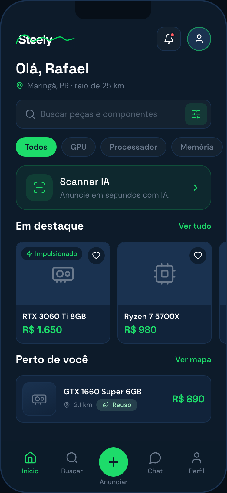
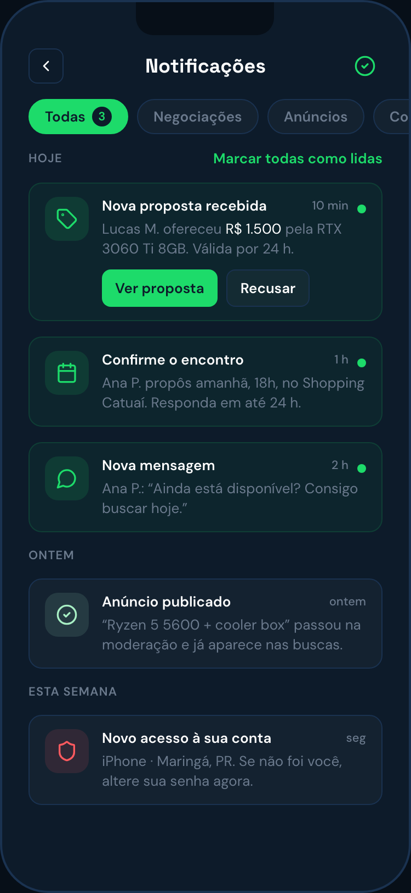
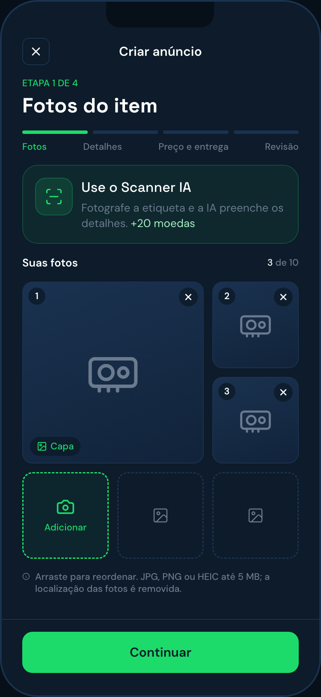
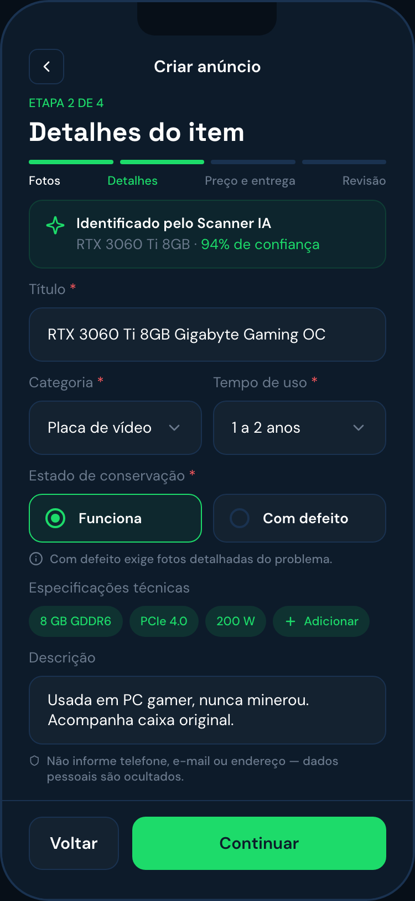
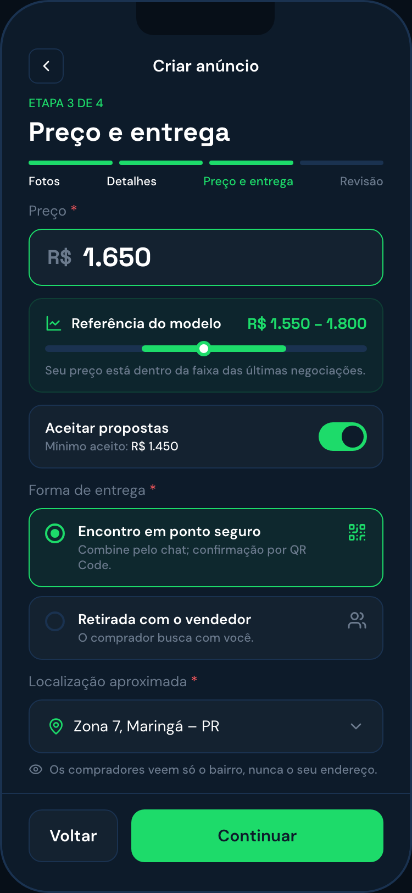
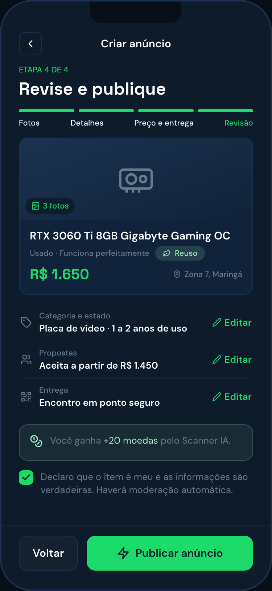

  
  
  
  
  

# Steely

**Marketplace de hardware de TI reaproveitável, com laudo técnico por Inteligência Artificial.**

Projeto acadêmico da **Escola de TI — UniCesumar** (2026). Veja o [site do projeto](https://rafaeltudelar.github.io/steely/) com o Scanner IA em 3D e os protótipos navegáveis.

> **Status: em desenvolvimento — 2º semestre de 2026 (Sprints 7–16).** A documentação está completa e os protótipos de tela estão sendo produzidos sprint a sprint. Quer ajudar? Veja [como contribuir](CONTRIBUTING.md).

---

## O problema

Todos os dias, empresas e pessoas descartam computadores e peças que ainda funcionam — só não servem mais para quem os tinha. Um PC com pouca memória RAM é "lixo" para uma empresa, mas é perfeito para virar um totem de sinalização digital ou o computador de uma sala de aula. Não existe hoje um lugar **confiável** que conecte quem quer se desfazer desse equipamento com quem precisa dele. E quem compra hardware usado em canais informais não tem garantia nenhuma sobre o estado real do produto.

## A solução

O Steely é uma plataforma (app Android + web + painel administrativo) que conecta três perfis:

| Perfil | O que faz |
|---|---|
| **Vendedor** | Anuncia o equipamento para vender, leiloar ou doar |
| **Comprador** | Procura exatamente a peça "imperfeita" que serve para o seu uso |
| **Instituição** (ONG, escola) | Solicita e recebe doações pelo Mural Institucional |

A confiança vem de duas camadas: um **laudo técnico gerado por IA** (o Scanner IA analisa as fotos e identifica o componente e seus defeitos) e a **validação da comunidade** (o Hardware Captcha).

### Principais funcionalidades

- **Scanner IA** — identifica o hardware pelas fotos e preenche o anúncio automaticamente
- **Hardware Captcha** — a comunidade valida se o anúncio corresponde ao produto
- **Chat interno** com bloqueio automático de telefones e e-mails
- **Leilões exclusivos** com moeda social e proteção anti-sniping
- **Agendamento e rotas** até o ponto de encontro, funcionando offline
- **QR Code de entrega** assinado digitalmente, validado mesmo sem internet
- **Garantia de 7 dias** com valor retido em custódia (escrow) e arbitragem de disputas
- **Carteira de moedas virtuais** (cashback)
- **Métricas ESG** (CO₂ evitado, material reaproveitado) e **relatórios DaaS** anonimizados sobre falhas recorrentes
- **Painel de moderação**

---

## O app

Protótipos de alta fidelidade da Sprint 13 — [todas as telas](docs/05-design/prototipos/) · [como fazer uma tela nova](docs/05-design/PASSO-A-PASSO-SIMPLES.md) ([guia completo](docs/05-design/GUIA-DE-PROTOTIPOS.md)).

  
  
  
  
  
  

---

## Arquitetura em uma frase

App **Expo** (Android) e SPA **React + Vite** (web) consomem uma API **FastAPI** (Python), que usa **Supabase** (PostgreSQL, Auth, Realtime, Storage) como banco e infraestrutura; o Scanner IA roda como um serviço separado com modelos **ONNX**.

Detalhes, diagrama de implantação e as 27 decisões de arquitetura (ADRs): [docs/04-arquitetura](docs/04-arquitetura/).

---

## Mapa do repositório

| Pasta | O que tem |
|---|---|
| [`docs/`](docs/) | **Toda a documentação do projeto** — comece por aqui |
| [`docs/01-gestao/`](docs/01-gestao/) | Termo de Abertura (TAP), matrizes (CSD, GUT, RACI, SWOT) e histórico das sprints |
| [`docs/02-requisitos/`](docs/02-requisitos/) | Requisitos, 58 casos de uso, regras de negócio e matriz de rastreabilidade |
| [`docs/03-modelagem/`](docs/03-modelagem/) | Diagramas de sequência, BPMN e de estados |
| [`docs/04-arquitetura/`](docs/04-arquitetura/) | Diagrama de implantação e os 27 ADRs |
| [`docs/05-design/`](docs/05-design/) | Manual da marca e protótipos de tela |
| [`docs/historico/`](docs/historico/) | Documentos do 1º semestre (versão anterior do produto) |
| [`backend/`](backend/) | API — FastAPI |
| [`web/`](web/) | Aplicação web — React + Vite |
| [`mobile/`](mobile/) | Aplicativo Android — Expo |
| [`database/`](database/) | Banco de dados — scripts SQL do Supabase |
| [`scanner/`](scanner/) | Scanner IA — visão computacional |
| [`ferramentas/`](ferramentas/) | Scripts que geram e verificam as telas e os links |
| [`site/`](site/) | Site do projeto (GitHub Pages) com a cena 3D e os protótipos navegáveis |

## Por onde começar a ler

1. **Este README** — o que é o Steely
2. [**TAP — Termo de Abertura**](docs/01-gestao/tap-termo-de-abertura-do-projeto.pdf) — objetivo, escopo e não escopo
3. [**Requisitos**](docs/02-requisitos/) — o que o sistema precisa fazer
4. [**Casos de uso**](docs/02-requisitos/casos-de-uso/) — como cada funcionalidade acontece
5. [**Arquitetura e ADRs**](docs/04-arquitetura/) — como e por que o sistema foi desenhado assim

---

## Linha do tempo

O projeto teve **duas gerações**. Saber disso evita confusão ao ler os documentos:

| Período | Produto | Numeração dos documentos |
|---|---|---|
| **1º semestre** (mar–jun/2026, Sprints 1–6) | Plataforma de doação e coleta de sucata eletrônica (Doador, Coletor, Instituição) | UC-01 a UC-18, RF-01 a RF-21 |
| **2º semestre** (ago–nov/2026, Sprints 7–16) | Marketplace de hardware com Scanner IA, leilões, moedas e escrow | STY001 a STY058, RF-01 a RF-22 (v2.0) |

Os documentos vigentes são os do 2º semestre. Os do 1º semestre ficam em [`docs/historico/`](docs/historico/) — **atenção: os mesmos números (ex.: RF-10) significam coisas diferentes nas duas gerações.**

---

## Equipe

| Nome | Papel / área principal | ADRs |
|---|---|---|
| Thiago Lopes Martins | Product Owner · back-end e contrato da API | 13–17 |
| Augusto Palma Guglielmi | Regras de negócio, conformidade (LGPD) e modelagem de dados | 03–07 |
| Fabricio Notoya Thomas | Scanner IA, banco de dados e segurança | 01–02, 08–12 |
| Pietro Pasqual Silva | Front-end web | 18–22 |
| Rafael Tudela Rizental | Mobile, prototipação e identidade visual | 23–27 |

Participaram do 1º semestre: Guilherme Pitão Garcia e Victor Hugo Silva Garcia.

A gestão foi compartilhada entre os colaboradores, com cerimônias Scrum semanais — veja [docs/01-gestao/scrum](docs/01-gestao/scrum/).

## Como contribuir

Toda mudança entra por Pull Request, com revisão e verificações automáticas. O passo a passo está em [CONTRIBUTING.md](CONTRIBUTING.md).

---

## Licença

Código sob a [licença MIT](LICENSE). Documentação, protótipos e manual da marca sob a [CC BY 4.0](LICENSE-DOCS.md) — use à vontade, citando a equipe.
