# Protótipos

[← Design](../README.md)

Telas de alta fidelidade do app mobile, feitas no Figma ([arquivo STEELY](https://www.figma.com/design/MZxnX0uT8BGIxpxkMFwUCj/STEELY)).

## Autenticação (versão de 13/09/2026)

| Tela | Caso de uso | |
|---|---|---|
| Logo | — | 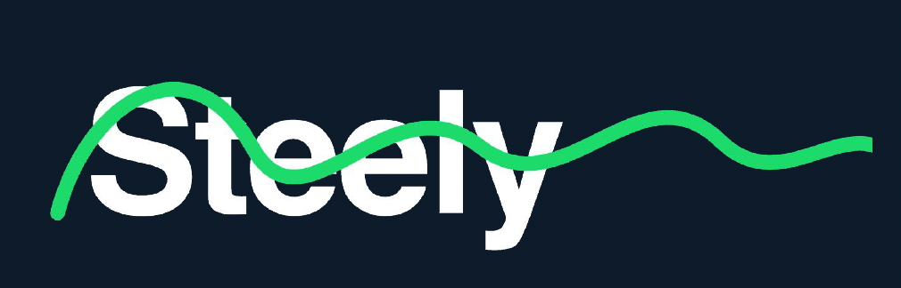 |
| Login | STY002, STY003 | 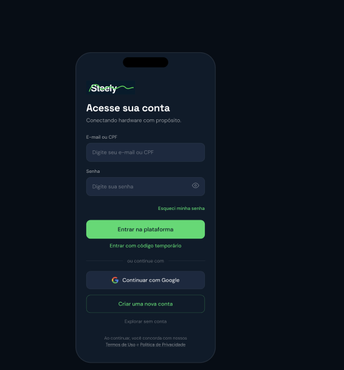 |
| Criar conta | STY001, STY004 | 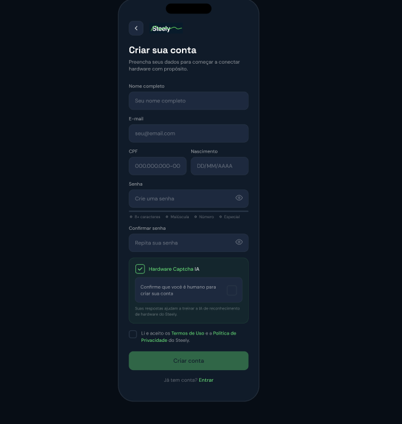 |
| Verificar e-mail | STY001 | 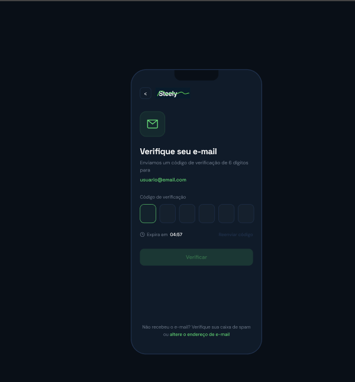 |
| Recuperar senha | STY005 | 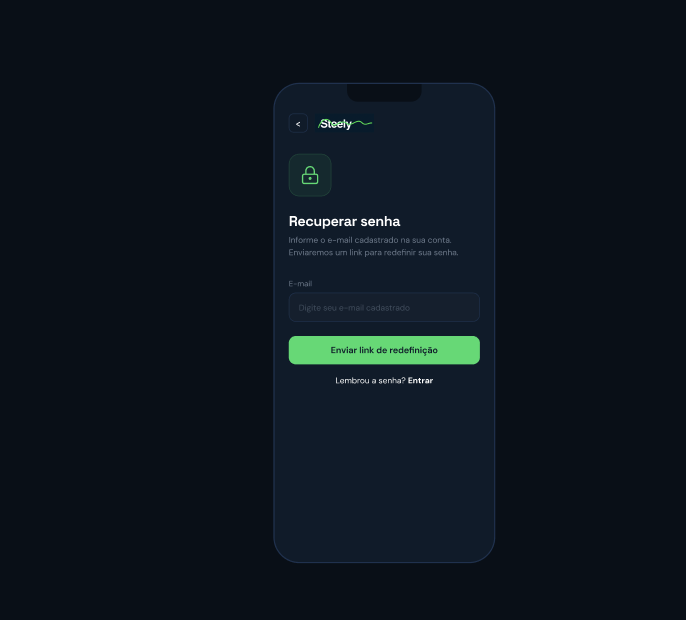 |
| Entrar com código | STY006 | 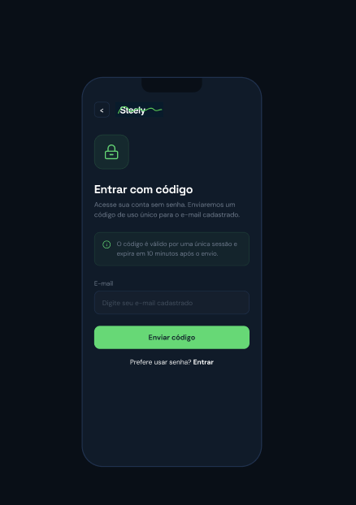 |

## Sprint 13 — Home, notificações e criação de anúncio

Geradas em HTML por [`ferramentas/prototipos/gerar_telas.py`](../../../ferramentas/prototipos/), aprovadas pelas verificações automáticas (paleta, tipografia e layout) e importadas no Figma com o plugin html.to.design. Cada pasta tem um arquivo por tela:

- [`html/`](html/) — o arquivo que vai para o Figma (1920×1200, celular 375×812 na posição 773,194)
- [`png/`](png/) — a captura do celular, gerada pelo `conferir_telas.py`

| Nº | Tela | Jira | Casos de uso | |
|---|---|---|---|---|
| 001 | [Home / Feed](html/001-home-feed.html) | EDTS-252 | STY020, STY017 | 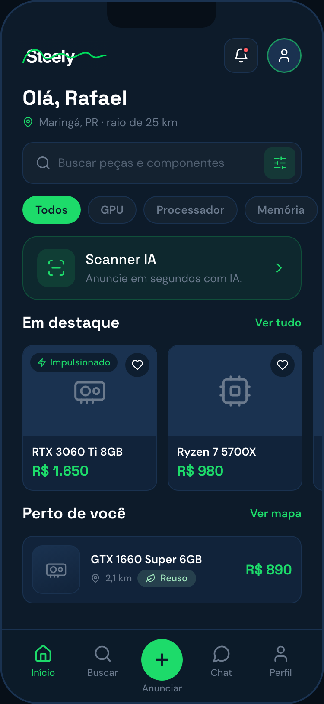 |
| 002 | [Central de Notificações](html/002-central-de-notificacoes.html) | EDTS-253 | STY021, STY025 | 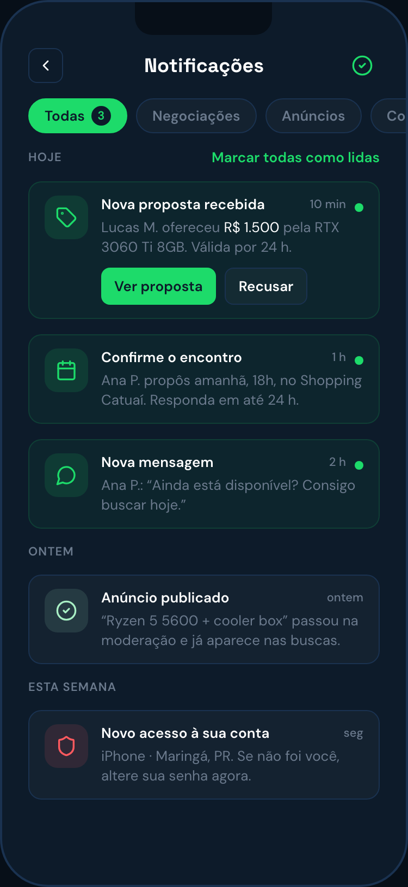 |
| 003 | [Criar Anúncio — Fotos](html/003-criar-anuncio-etapa-1-fotos.html) | EDTS-254 | STY016, STY017 | 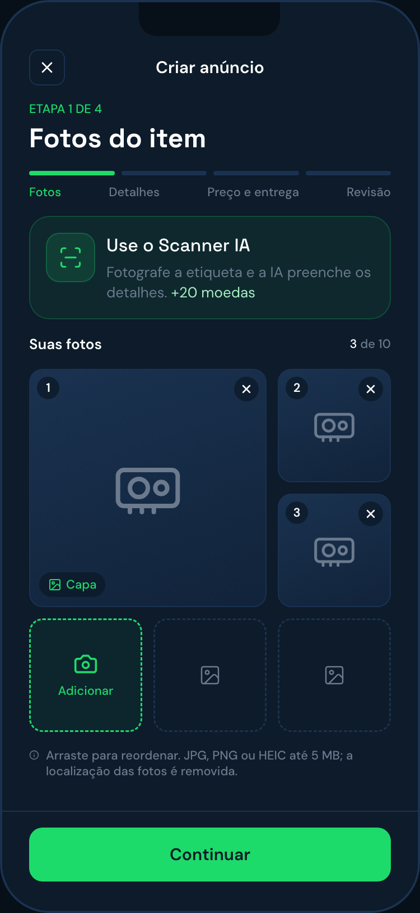 |
| 004 | [Criar Anúncio — Detalhes](html/004-criar-anuncio-etapa-2-detalhes.html) | EDTS-255 | STY016, STY055, STY052 | 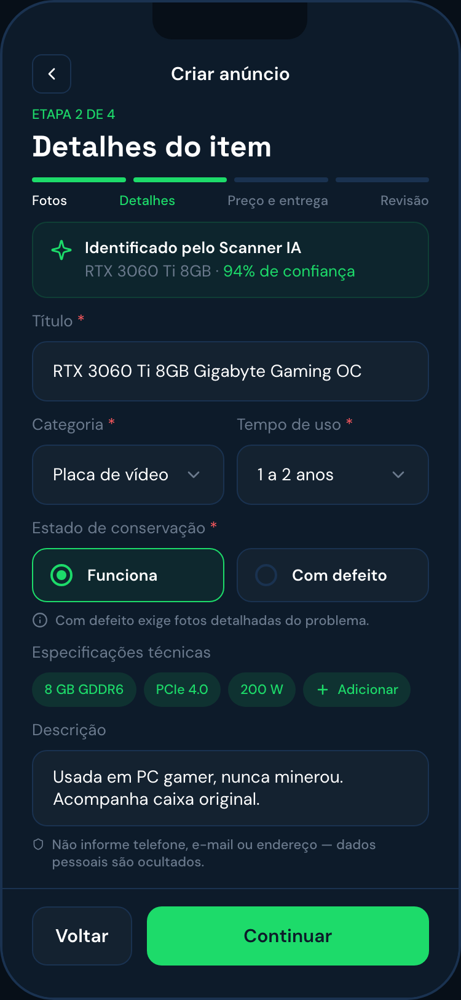 |
| 005 | [Criar Anúncio — Preço e entrega](html/005-criar-anuncio-etapa-3-preco-e-entrega.html) | EDTS-256 | STY016 | 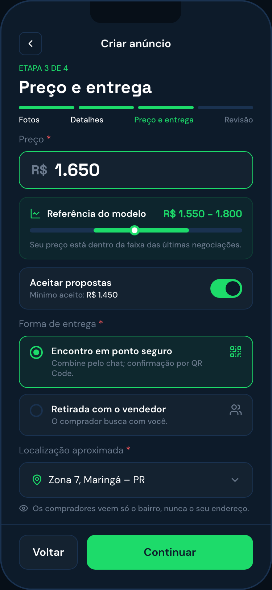 |
| 006 | [Criar Anúncio — Revisão](html/006-criar-anuncio-etapa-4-revisao.html) | EDTS-257 | STY016 | 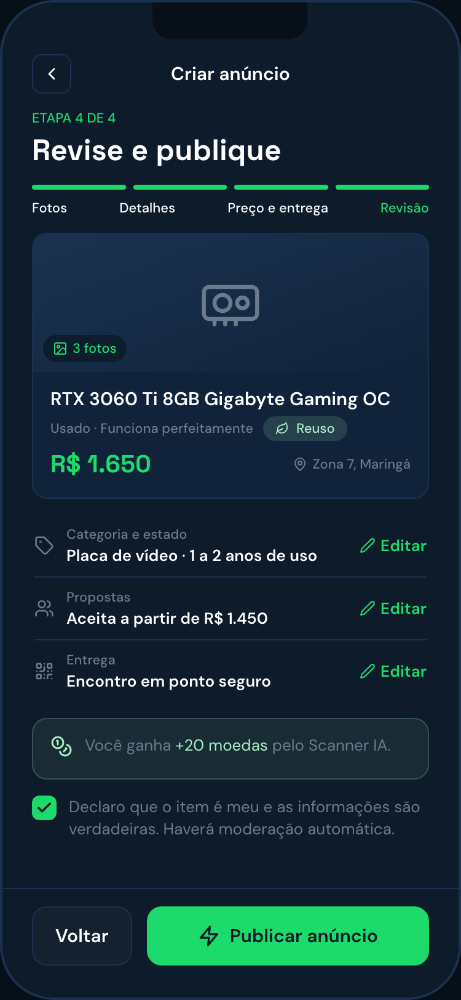 |

## Histórico — versões anteriores

Primeiras versões das telas de autenticação, anexadas nas tarefas de prototipagem do Jira. Ficam aqui para mostrar a evolução do design; a versão atual é a da seção [Autenticação](#autenticação-versão-de-13092026).

| Sprint | Tela | Jira | |
|---|---|---|---|
| 8 (30/08/2026) | Login — primeira versão | EDTS-103 | 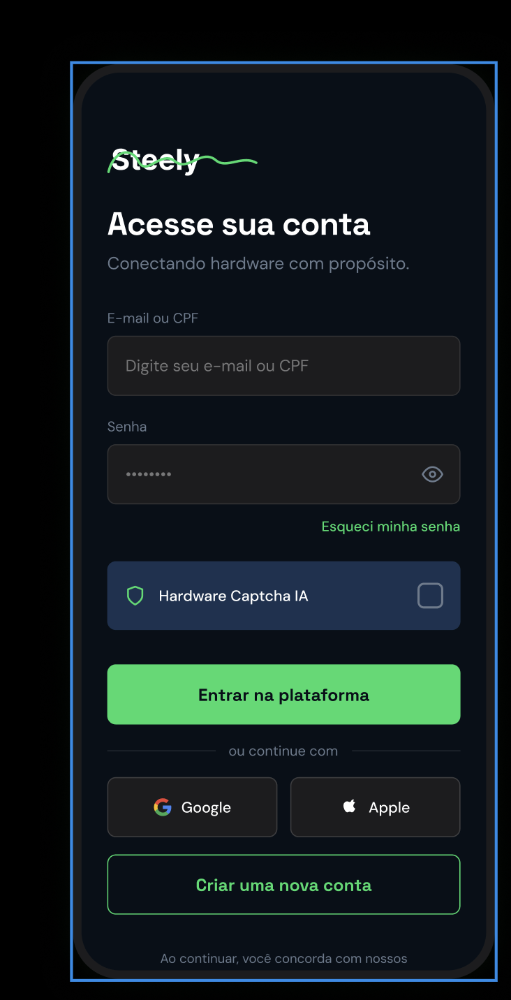 |
| 9 (06/09/2026) | Login — segunda versão | EDTS-124 | 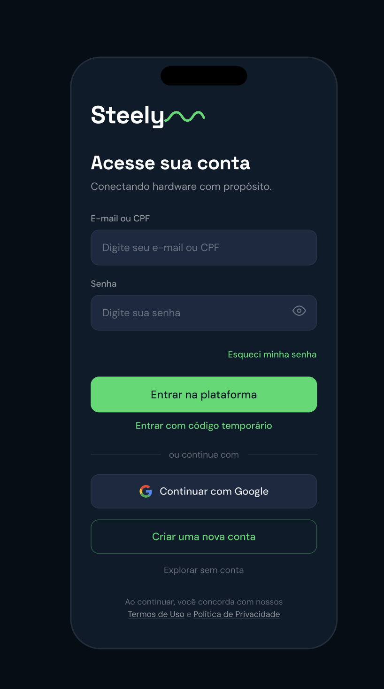 |
| 9 (06/09/2026) | Criar conta — primeira versão | EDTS-124 | 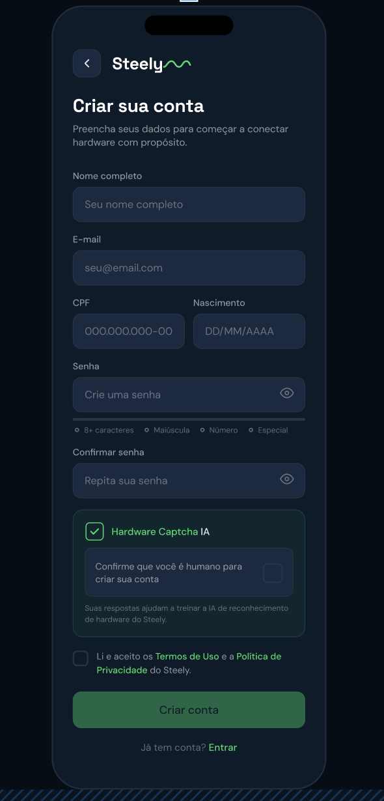 |

As telas de autenticação da Sprint 10 (EDTS-173) são as da seção Autenticação acima. As tarefas EDTS-191 (Sprint 11) e EDTS-203 (Sprint 12) não têm imagens anexadas no Jira.

As demais telas (chat, propostas, agendamento, garantia e disputas — tarefas `PROTOTIPAGEM` no Jira) seguem o mesmo processo: veja o [Guia de protótipos](../GUIA-DE-PROTOTIPOS.md).
