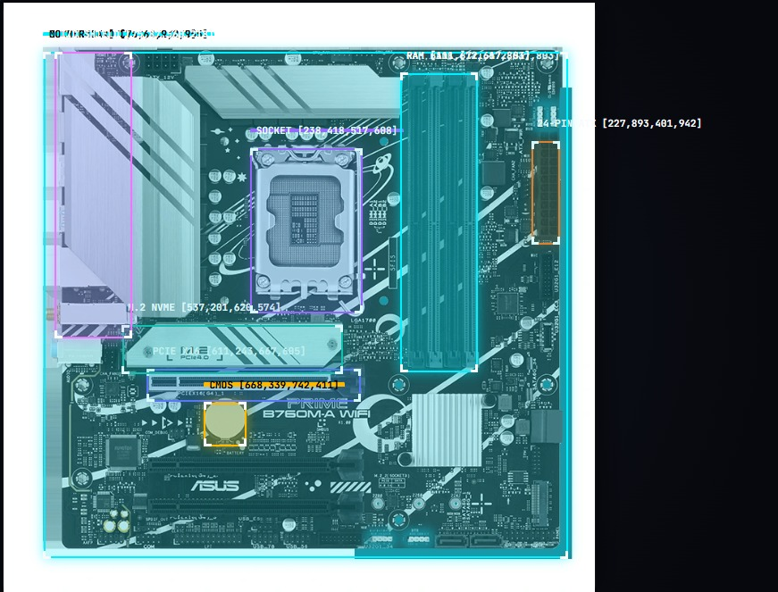

# Scanner IA

[← Início](../README.md)

Serviço de visão computacional que identifica o hardware pelas fotos do anúncio e gera o laudo técnico automático.

*Exemplo da auto-anotação usada para montar o dataset de treino.*

## Como funciona

1. **Detecção** — localiza os componentes na foto (detector YOLO11s).
2. **Classificação hierárquica** — do geral ao específico (níveis L0 a L4: categoria, linha, série...).
3. **Identificação do modelo exato** — busca vetorial com FAISS (nível L5), para distinguir placas visualmente "gêmeas".
4. **Leitura da etiqueta** — OCR (PaddleOCR).
5. **Decisão por confiança** ([ADR-12](../docs/04-arquitetura/adr/adr-12-limiar-de-confianca-do-scanner.md)):

| Confiança | O que acontece |
|---|---|
| ≥ 80% | Anúncio preenchido automaticamente |
| 50% – 79% | O vendedor escolhe entre as 3 hipóteses mais prováveis |
| < 50% ou falha | Preenchimento manual, e a foto vai para curadoria |

Os modelos rodam em **ONNX** num serviço separado da API, e a resposta precisa sair em até 4 segundos (`RNF-05`). Se o serviço falhar, um *circuit breaker* leva o vendedor direto ao preenchimento manual.

## Decisões que se aplicam aqui

| ADR | Assunto |
|---|---|
| [ADR-01](../docs/04-arquitetura/adr/adr-01-motor-do-scanner-ia.md) | Arquitetura e motor de visão computacional |
| [ADR-12](../docs/04-arquitetura/adr/adr-12-limiar-de-confianca-do-scanner.md) | Limiar de confiança |
| [ADR-11](../docs/04-arquitetura/adr/adr-11-armazenamento-de-imagens.md) | Armazenamento de imagens (sem EXIF/GPS) |
| [ADR-27](../docs/04-arquitetura/adr/adr-27-captura-e-compressao-de-imagem.md) | Captura e compressão no celular |

## Código

*Ainda não adicionado a este repositório.*
